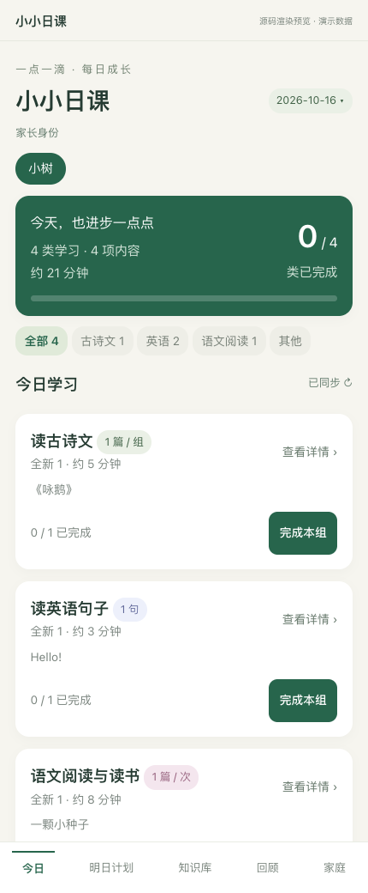
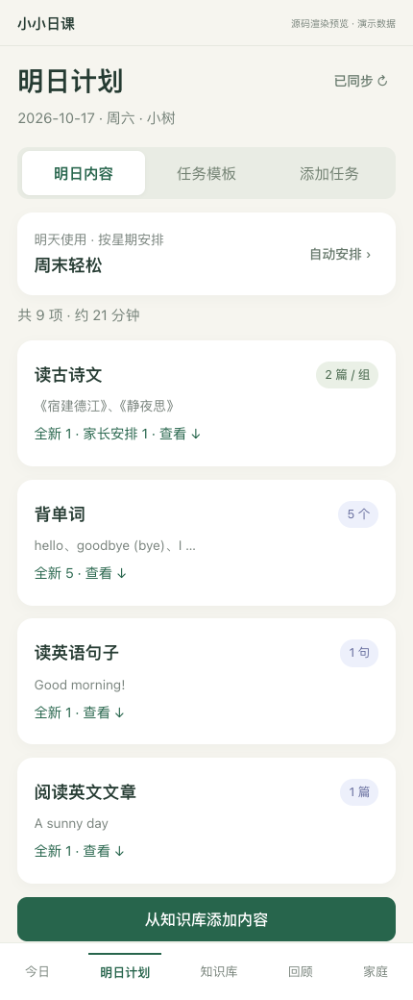
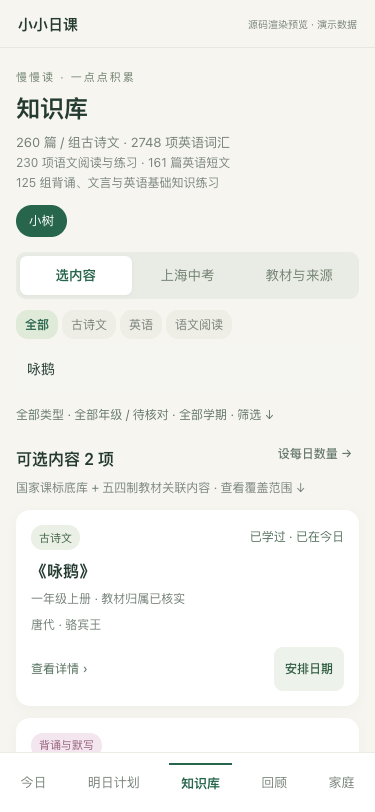
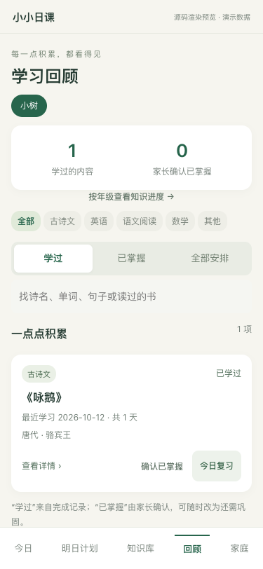
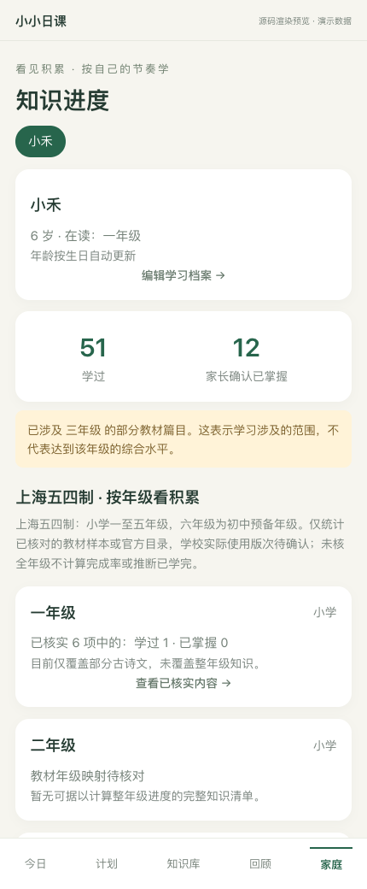
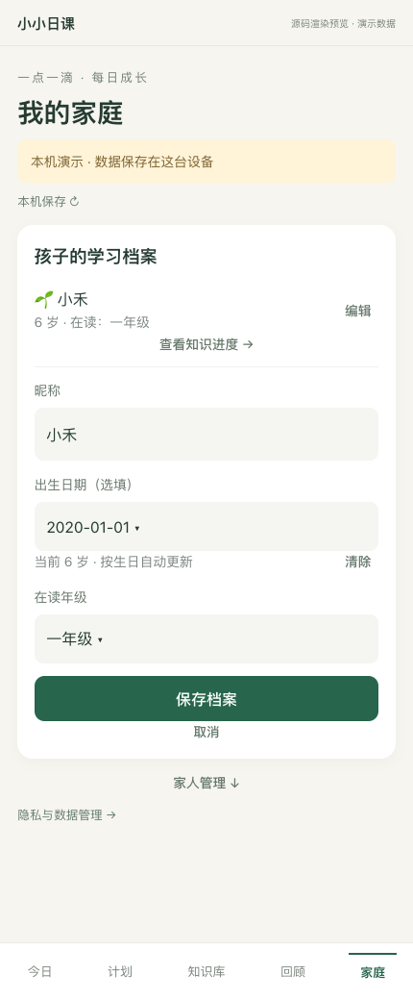

# 小小日课 · Family Learning

**每天一点积累，看见孩子的学习进步。**

面向家庭的学习计划与进度管理工具。家长安排古诗文、英语和阅读任务，孩子按类型学习并提交录音或照片，家长确认完成，共同记录与回顾。使用微信原生小程序和腾讯云开发 CloudBase，支持本机演示与家庭云同步。

[](https://github.com/NginxL/family-learning-miniprogram/actions/workflows/verify.yml)


[界面预览](#界面预览) · [当前功能](#当前功能) · [知识库覆盖](#知识库覆盖) · [本地运行](#本地运行) · [接入云开发](#接入云开发) · [文档导航](#文档导航)

> **发布状态 · 2026-10-21**：账号持有人已确认备案通过及两台手机同步正常，`1.1.0`待发布、`1.2.0`待提交审核。`1.2.0`应用提交 `bc0c6d2` 通过309项测试，云函数已部署并逐文件回读核对；发布目标为新版 `1.2.0`，详见[发布记录](docs/RELEASE.md)。公开源码默认使用本机演示数据；真实多手机同步需要配置自己的 AppID、云环境并部署云函数。

> **功能测试版 · 2026-10-22**：323项测试通过，修复孩子微信绑定按钮，当前模板支持即时调整今日未完成自动任务；新增古诗、单词、句子和文章朗读。云函数已更新，免费语音已启用，后付费关闭，真实中英文合成验证通过；客户端仅生成测试预览，真机待验收。原有学习记录兼容，详见[朗读与今日模板](docs/朗读与今日模板.md)。

## 界面预览

以下是当前源码的浏览器渲染预览，使用虚构档案与本机演示数据，**不是微信真机截图**。点击图片查看原图；渲染方式与差异见[预览说明](docs/images/README.md)。

<table>
  <tr>
    <th width="33%">今日 · 按类型打卡</th>
    <th width="33%">明日计划 · 提前安排</th>
    <th width="33%">知识库 · 内容与来源</th>
  </tr>
  <tr>
    <td align="center"><a href="docs/images/today.png"></a></td>
    <td align="center"><a href="docs/images/plans.png"></a></td>
    <td align="center"><a href="docs/images/library.png"></a></td>
  </tr>
  <tr>
    <th>回顾 · 学过与掌握</th>
    <th>进度 · 按年级看积累</th>
    <th>家庭 · 成长档案</th>
  </tr>
  <tr>
    <td align="center"><a href="docs/images/history.png"></a></td>
    <td align="center"><a href="docs/images/progress.png"></a></td>
    <td align="center"><a href="docs/images/family.png"></a></td>
  </tr>
</table>

点击学习卡片后查看完整任务：[古诗文详情](docs/images/study-poetry.png) · [语文阅读与拼音](docs/images/study-reading.png) · [单词详情](docs/images/study-word.png) · [英文阅读详情](docs/images/study-english-reading.png)。长列表分批展示，家长可完成或撤销整组，孩子进入提交作业。

安排学习：[每日任务模板](docs/images/templates.png) · [按星期自动安排](docs/images/plans-weekly.png) · [日期选择](docs/images/library-date.png) · [明日任务改期与删除](docs/images/plans-edit.png)。

独立微信角色：[孩子提交作业](docs/images/homework-child.png) · [家长确认与反馈](docs/images/homework-parent.png)。绑定与隐私配置见[使用说明](docs/HOMEWORK.md)。新版详情页支持可选的中英文朗读，免费额度、数据流与验收状态见[朗读与今日模板](docs/朗读与今日模板.md)。

## 当前功能

**计划安排 → 今日学习 → 历史回顾 → 知识进度**。知识库内容可以安排到今日、明日或未来指定日期；「明日计划」提前显示下一天的学习内容，回顾中学过的内容可以再次安排复习。

| 场景 | 可以做什么 |
|---|---|
| 家庭与孩子 | 首次打开自动准备默认家庭；最多 5 个孩子，生日自动计算周岁，在读年级单独维护。云端分别邀请家长、绑定孩子独立微信，孩子只访问绑定档案 |
| 明日计划与模板 | 每个孩子保存多个模板，可每天使用一个，也可区分周一至周五和周末。各类数量集中编辑，新学／复习和范围按需展开；古诗文可选必背优先或只选教材必背。点击次日分组卡片进入详情，未完成安排可改期、删除，同日去重 |
| 今日与详情 | 按类型显示摘要，整张卡片进入正文与来源；首页隐藏数学筛选，旧数学任务仍可在「全部」查看。详情每批 20 项，一组一个完成／撤销入口；已注音的语文内容可开关拼音 |
| 作业提交 | 孩子在详情页拍照或录音提交；家长查看附件、确认整组完成或反馈退回。每次最多3份附件，单份512KiB，录音60秒 |
| 知识库 | 展示古诗文朝代与作者；可搜索朝代，按类型、课标范围、教材年级／上下册及教材必背／熟读成诵筛选，进入具名教材后可按单元查看；选择今日、明日或一年内指定日期，数学已从可选列表移除 |
| 回顾与进度 | 查看学过、家长确认掌握的内容，安排复习；年龄、在读年级和知识积累分别展示，支持近一年日期记录 |

今日、明日计划、知识库与回顾的学习卡片共用一个组件，整张点击进入详情。知识库详情底部可直接「安排日期」，选择今日、明日或未来一年内的日期；列表与详情共用安排逻辑。正文保留朝代作者和背诵要求，教材版本、核对说明与来源链接收在默认折叠的「来源详情与说明」。完成、确认掌握和复习操作保持独立；回顾保留所选记录的正文，查看内容不改变学习状态。

查看界面：[知识库详情](docs/images/knowledge-detail.png) · [详情内安排日期](docs/images/knowledge-date.png)。

在「明日计划 → 任务模板」保存模板，再进入「自动安排」选择使用方式。开启按星期使用后，周一至周五与周末（周六、周日）可使用不同模板，按自然星期循环。新版服务支持保存当前使用的模板后即时调整今日未完成自动任务；已完成、手动安排和已交作业的任务保留。旧客户端或旧服务沿用原来的次日生效方式。旧每日数量配置显示为「每日积累」，无需重新填写。语文阅读与英文阅读可分别设置篇数，使用内置入门短文，也可由家长补充自动内容库；内容不足时提示缺额。

全新任务排除曾经安排过的内容；普通单次添加过滤已学内容，提前学完的未来安排也会过滤。同一孩子同一天的相同内容仅安排一次；主动复习及每天固定的任务保留重复学习。明日预览随今日学习更新，不计入学习历史。改期和删除只调整这一次未完成安排，已完成记录保持不变。**完成打卡与确认掌握分开记录**，不会因一次完成就判定已经掌握。

云端打卡先写入本机队列，再同步到家庭档案；打开应用、恢复网络及前台每 20 秒触发同步，后台／锁屏不保证运行。冲突会提示重新确认，具体机制见[实现与验证边界](docs/MVP.md)。

## 知识库覆盖

目标是覆盖**上海闵行五四学制：小学1–5年级、初中6–9年级（六年级为预备年级）**的语文与英语，为上海中考积累基础。语文包括识字、古诗文、阅读与表达，英语包括语音、词汇、语法、听说、阅读与写作。课标目录、教材年级和中考范围分别核验，不能相互替代。

| 内容 | 当前内置 | 覆盖说明 |
|---|---:|---|
| 古诗文 | 261 项 | 含组与节选，涵盖国家课标135篇／组；均有朝代或时代标签，《画》保留待考 |
| 英语词汇 | 2,748 项 | 国家主表1,600组、另列表77项，补充教材字词1,071项；常用义与单元义分别保留。十册原书2146个单元词项补录词性和释义，原书未标词性的表达如实区分；404项具体教材年级学期待核实 |
| 英语句子与阅读 | 690 句 + 161 篇 | 含一至九年级十八册155个分组的678句原创例句、155篇原创短文与问答；三至五及九年级下册为旧版参考；六、七年级含Starter，六至九年级附自编语法提示 |
| 语文阅读与练习 | 230 项 | 79组教材识字写字、145份单元／栏目原创阅读与练习、6篇入门短文；历史数学任务与记录继续兼容 |
| 基础知识练习 | 129 组 | 背诵默写9、文言理解55、词汇运用10、英语语法55；均有讲解和问答，独立安排与记录 |
| 逐册覆盖清单 | 36 个学科册次 | 9年级 × 2学期 × 语文／英语；按年级查看官方书目来源和知识缺项，书目索引不等于教材内容全量 |

知识库内容详情和学习详情支持「显示／隐藏拼音」。在读一年级、二年级默认显示已收录的注音；当前覆盖31篇古诗、151份原创阅读／拼音练习、79组识字写字和2组低年级背诵练习，正文变动或未收录的内容保留原文。注音辅助不改变教材年级归属，详见[阅读与拼音范围](docs/阅读与拼音.md)。

**当前不是上海中考或各年级的完整教材库。** 一至九年级三十六册共300个学习分组有可直接学习的配套内容，包含语文诵读附录和英语Starter；小学语文十册识字、写字表已整理。五上语文按国家平台2024审核原书核对，五下按国家平台2019审定原书核对，分别保留版本标识。五年级两册有35处古诗文映射、17篇原创阅读与问答。

小学统一复核补充17处古诗文教材关联。一年级上下册按官方音频核对完整Word bank 59／64项；二上样本原页43项、二下官方音频43项，纸本与音频差异保留。三至五上国家平台原书Words to use分别为159／141／113个单元词项，四、五上另有目录主题词5／9项。三至五下61／61／98项仍为历史试用本参考，见[小学统一复核](docs/一至五年级统一复核.md)。

知识库「筛选 → 学习方向」可查看基础练习，并加入今日、明日或指定日期。原作卡片另列138处原书记诵要求，区分全文、指定范围、默写与熟读成诵；55篇文言原作附字词、句意与理解，并补课后字词、文化和迁移练习；646项英语词卡附词形、短语或词族。132处背诵／默写要求各配范围一致的自测，非教材默写要求另标自选训练；《赋得古原草送别》前四句有独立学习卡。讲解和答案默认折叠，知识库与今日详情均可展开；查看不会自动打卡，也不增加每日模板的数量。来源与未核范围见[逐篇辅助核验](docs/背诵要求与逐篇辅助核验.md)，独立练习及课标层次见[基础知识核验](docs/基础知识体系核验.md)。

[一至九年级统一复核](docs/一至九年级统一复核.md)集中列出36册版本、七册旧版下册依据和知识缺口。2026春季官方目录仍列三至五及九下英语试用本，但不能据此推定2027春季或学校采用版本。已有知识ID与历史记录保留，词义补充、教材来源升级和篇目去重分别验证。

开发分支在1.1.0之后修订了语法、6篇原创阅读和18个具名多义词，另补982个词卡的有来源常用义与45组句型用法；来源中区分官方原书、官方音频与第三方样本。修订内容、原书页码和词典依据见[复审核验](docs/复审修复核验-2026-10-19.md)及[三上证据与新增词义核验](docs/第四轮复核修复核验.md)。这些修订已于2026-10-21同步到云函数和已上传的1.2.0客户端，1.1.0审核包未改动，新版提审待完成。

一上、一下、二上、三上的31处古诗文位置已逐页对照国家平台官方原书，来源改为对应原书；年级、学期、单元和页码保持不变。字表等尚未独立复核的关联继续标注第三方依据，详见[位置核验记录](docs/低年级古诗文位置官方核验.md)。

英语词卡保留已有基础常用义，按原书区分不同单元的词性和意思；599张词形卡的练习明确对应义项，例如 companies 对应“公司”、lighter 对应“轻的”。旧任务正文保留，并可在来源详情核对新版词卡。原书页码、13处释义勘误、核验方法及待确认范围见[英语词汇核验](docs/英语词汇勘误核验.md)。

2026-10-18复查国家平台、人教社及上海教育出版社目录，七册仍未确认可替换的新版原书。小程序“教材与来源”显示逐册核验日期、旧版状态及待确认项；语文四、五、九下为2019审定原书，英语三、四、五、九下保留试用本音频选词，不标作新版全词表。[沪教委基〔2024〕19号](https://www.shqp.gov.cn/edu/edu/upload/202408/0829_152637_882.pdf)规定2026学年起全覆盖新教材；七册旧版仅作历史参考，对应新版下册原书仍待核实。

六年级按**上海初中预备年级**入库：语文上下册各7单元及诵读附录，26处古诗文关联、16篇原创阅读与问答；英语上下册完整单元词表277／256项，含跨单元复现，另有13组原创阅读、78句例句与语法提示。原书、纸本印次和学校采用分别记录，现代课文全文及所有知识点尚未全量覆盖，见[六年级教材核验](docs/六年级教材核验记录.md)。

七年级语文上下册各6单元及两组诵读附录，核实38处古诗文并提供16篇原创阅读练习；英语完整单元词表255／278项，另有13篇原创阅读、78句例句与语法提示。四册均核对国家平台五四制2022课标修订原书，纸本ISBN、学校印次仍待确认；详见[七年级教材核验](docs/七年级教材核验记录.md)。

八年级语文两册核实48处古诗文，提供16篇原创阅读练习；英语两册完整单元词表260／208项，另有12篇原创阅读、72句例句与语法提示。四册均核对国家平台五四制原书，篇目异文和《孟子》分章对应关系单独记录；详见[八年级教材核验](docs/八年级教材核验记录.md)。

九年级语文两册核实47处古诗文，提供16篇原创阅读练习；英语九上完整单元词表199项，九下官方配套音频选词159项，另有11篇原创阅读、66句例句。**语文九下为2019审定原书，英语九下为旧版试用本参考**，不与2024审核上册视作同一版全套；学校用书及新版下册待确认，见[九年级教材核验](docs/九年级教材核验记录.md)。

知识库卡片显示当前孩子的「已学过／已掌握」，进入详情可见最近学习日期和学习天数；筛选可查看已学或未学内容。只有家长确认完成才计入已学，断网时会标明缓存状态。

「教材与来源」提供九个年级的逐册清单。语文18册入口核对自人教社五四学制目录；英语基础书目依据上海平台2026学年第一学期及2025学年第二学期资源表，后续取得的国家平台具名原书单独核验，不混成同一学年全套。核验记录见[九年覆盖清单](data/catalogs/shanghai-54-coverage.json)。

教材年级进度统计有具名教材关联的字词、古诗等条目，并单独显示仅有第三方样本依据的数量；单元原创练习和家长自行标注的年级分别展示；缺少完整分母时不显示整年级完成率。涉及高年级篇目也不代表达到该年级的综合水平。详见[知识库与年级核验](docs/知识库与年级核验.md)、[上海中考范围与缺项](docs/上海中考知识范围与覆盖.md)及[数据来源与许可](data/catalogs/README.md)。

本轮待办的完成范围、兼容性、词典许可与评审步骤见[知识库待办验收](docs/知识库待办验收.md)。新必背模板需要新版服务支持；2026-10-21测试二维码已连接更新后的云端，既有家庭记录保留，1.1.0审核包未改动。

## 本地运行

需要 **Git、Node.js 20+、微信开发者工具**。本机演示无需购买或连接云环境。

```sh
git clone https://github.com/NginxL/family-learning-miniprogram.git
cd family-learning-miniprogram
npm ci
npm ci --prefix cloudfunctions/familyApi --ignore-scripts
npm run configure
npm run build
npm run verify
```

在微信开发者工具中导入**仓库根目录**，读取生成的 `project.config.json`。未设置 AppID 时可使用测试号／游客模式。

首次打开自动进入默认家庭并生成今日任务。初始孩子昵称为「孩子」、6 岁、一年级，可在「家庭」编辑；进入「明日计划」查看次日任务、设置每日模板，在「今日」点击学习卡片查看详情，或直接完成本组。

| 运行方式 | 数据位置 | 家人同步 |
|---|---|---|
| 本机演示（默认） | 当前设备本地存储 | 不连接云端，不支持真实邀请或跨设备同步 |
| 云端运行 | 自有云环境＋设备缓存 | 通过家庭邀请共享档案，需完成下方部署 |

模拟身份仅用于演示和测试，生产函数只使用微信提供的 `OPENID`。截图里的“小禾”是演示档案，克隆后的默认档案不含真实家庭信息。

## 接入云开发

准备自己的小程序 AppID 与已关联的 CloudBase 环境后执行：

```sh
npm run configure -- --appid wxYOUR_APP_ID --env YOUR_CLOUDBASE_ENV_ID
```

将占位参数替换为真实编号。命令生成被 Git 忽略的本地配置；**仅设置环境 ID 不会自动部署后端**。

1. 按[部署说明](docs/DEPLOYMENT.md)创建数据库集合、配置访问规则并部署 `familyApi`。
2. 在微信开发者工具生成预览，确认能读取档案并显示「已同步」。
3. 由家庭创建者在「家庭 → 家人管理」生成邀请码，另一微信账号加入后验证双方打卡同步。

预览／体验阶段仍受微信账号权限限制；正式发布后无需体验名单，但加入已有家庭仍需邀请码。备案、代码审核与正式发布步骤见[发布说明](docs/RELEASE.md)。云端运行可能产生服务费用，以自己的环境套餐为准。

公共仓库不包含真实 AppID 配置、AppSecret、上传私钥、访问密钥、邀请码或家庭记录。云函数使用运行时身份访问数据库，无需将云密钥放进代码。

## 工程结构

知识库、学习记录、云函数核心、页面和同步队列已迁到 TypeScript；演示后端及构建脚本仍使用 JavaScript。构建保持现有运行入口和缓存格式，详见[TS 迁移与构建约定](docs/TYPESCRIPT.md)。已通过审核的 `1.0.1` 小程序包保持不变；新角色与作业功能的部署、隐私配置和真机验收见[作业说明](docs/HOMEWORK.md)。

```text
src/shared/                 TS 知识模型、学习记录、接口约定与规则
src/cloud/                  TS 云函数入口、权限与数据库适配
src/client/                 TS 云函数调用适配
src/miniprogram/            TS 应用入口、页面状态与事件、同步队列
miniprogram/                微信运行产物、模板、样式及演示后端
cloudfunctions/familyApi/    家庭权限、任务与事务 API
cloud/                      数据库及云存储的客户端拒绝读写规则
tests/                      家庭隔离、冲突、离线重试和 SDK 契约测试
shared/                     共用规则的生成 JS，供 Node 测试与工具使用
data/catalogs/              课标目录、原作、词表与教材证据
scripts/knowledge.js        从源数据生成内置知识库
docs/                       部署、边界与调研来源
```

| 命令 | 用途 |
|---|---|
| `npm run typecheck` | 严格检查 TS 源码、页面字段、离线队列与接口调用的类型测试 |
| `npm run build` | 校验知识源结构，编译 TS 并生成客户端、云函数运行文件 |
| `npm run verify` | 类型检查、生成文件一致性、JS/JSON、页面入口、包体与行为测试 |
| `npm audit --prefix cloudfunctions/familyApi --omit=dev` | 检查云函数生产依赖的已知漏洞 |

GitHub Actions 执行构建一致性、行为测试与依赖审计。测试使用隔离内存事务和两个独立客户端缓存，不等于真实云环境或真机验收。

修改 `src/` 或 `data/catalogs/` 后运行 `npm run build`；生成结果随代码提交。带 `Generated` 标记的 JS 由 TS 或知识源生成，检查脚本会拒绝过期或被单独修改的产物。

## 文档导航

| 主题 | 文档 |
|---|---|
| 部署与发布 | [云开发部署](docs/DEPLOYMENT.md) · [备案、审核与发布](docs/RELEASE.md) |
| 实现与验收 | [MVP 功能、同步与权限边界](docs/MVP.md) · [角色绑定与作业](docs/HOMEWORK.md) · [TS 迁移与构建](docs/TYPESCRIPT.md) · [预览图片说明](docs/images/README.md) |
| 本轮评审 | [待办完成范围、来源、兼容性与测试步骤](docs/知识库待办验收.md) |
| 知识库与来源 | [年级核验](docs/知识库与年级核验.md) · [三年级逐册证据](docs/三年级教材核验记录.md) · [四年级逐册证据](docs/四年级教材核验记录.md) · [五年级逐册证据](docs/五年级教材核验记录.md) · [六年级逐册证据](docs/六年级教材核验记录.md) · [七年级逐册证据](docs/七年级教材核验记录.md) · [八年级逐册证据](docs/八年级教材核验记录.md) · [九年级逐册证据](docs/九年级教材核验记录.md) · [上海中考覆盖](docs/上海中考知识范围与覆盖.md) · [数据来源与许可](data/catalogs/README.md) |
| 设计参考 | [GitHub 界面与动线参考](docs/GitHub界面与动线参考.md) |

## 当前限制与反馈

- **上线与实机验证**：已完成单台手机云端读取；两个微信账号同步、完整原生流程和正式版陌生账号验收仍待完成。
- **学习内容**：年级全量、教材版次、其余篇目拼音仍待核验或实现；可选合成朗读的接入及验收状态见[朗读与今日模板](docs/朗读与今日模板.md)；当前没有录音评分或间隔复习算法。
- **数据管理**：自助导出、删除及完整恢复待实现，当前由环境管理员核实权限后处理。

问题和改进建议可提交 [Issue](https://github.com/NginxL/family-learning-miniprogram/issues)。界面问题请提供复现步骤、微信／基础库版本与脱敏截图；知识内容问题请附教材版次、页码或公开来源。请勿上传孩子真实档案、家庭邀请码或账号密钥。

## 许可与内容使用

本仓库源码公开可读，**当前尚未声明项目源码的开源许可证**，不能默认按 MIT 等许可使用。第三方资料按各自来源和许可处理，详见[数据来源与许可](data/catalogs/README.md)、[ECDICT MIT 许可](licenses/ECDICT-MIT.txt)、[Open English Wordnet CC BY 4.0](licenses/Open-English-Wordnet-2025.txt)及[随包第三方声明](miniprogram/THIRD_PARTY_NOTICES.txt)。

教材整册、配音和现代注释没有随源码打包。真实家庭档案与学习记录保存在所配置的云环境和设备缓存中，不属于公开仓库内容。
