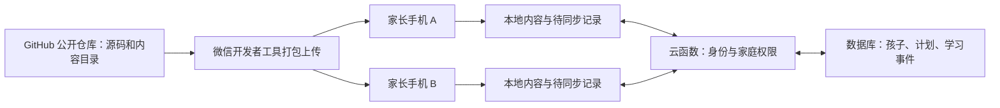

# 上海闵行家庭学习小程序调研

核对日期：2026-10-12。使用对象：刚入一年级的孩子和家人。第一阶段覆盖古诗文、英语；家人需要多台手机自动同步；旧源码按遗失处理，源码保存到 GitHub 公开仓库，真实配置与家庭数据不入库。

**建议采用微信小程序＋微信云开发，先做家庭体验版，再根据账号和类目情况决定正式发布。按当前个人主体、云开发个人版价格，基础年费参考约 269 元，预留 300–500 元／年更便于安排。** 这是基础运行预算，不含开发人力、教材与音频授权、英语考试、额外 AI 调用和资源超额费用。

如果“学习数据不放云端”是硬要求，也有可行方案：家中常开电脑或 NAS 保存数据，手机接入同一局域网后自动同步。微信官方支持这种局域网通信；离家后只能先保存本地记录，回家再同步。完全不依赖微信分发则改为局域网网页，扫码打开的是网页。

## 1. 古诗文：全量的边界与基础目录

### 已确认事实

闵行属于上海统一中考体系。语文、外语等科目由市教育考试院统一命题、组织和评卷；区和学校的日常学习安排需要另行映射。[上海市初中学业水平考试实施办法](https://edu.sh.gov.cn/xxgk2_zdgz_rxgkyzs/20230412/ec0b8612c5c14970ad0260593696af43.html)

教育部《义务教育语文课程标准（2022年版）》附录1明确列出 **135 篇／段**：1–6 年级 75 篇、7–9 年级 60 篇／段。后者包含诗词曲，也包含《论语》十二章、《孟子》三则、《岳阳楼记》等文言文。只收“古诗词”会漏掉中考前的重要内容。[课标原文，印刷页58–63](https://www.moe.gov.cn/srcsite/A26/s8001/202204/W020220420582344386456.pdf)

135 是课标推荐条目的数量。多章、多则选段在原目录中可能合计一条，不能当成135个完全独立的背诵任务。课标还明确允许教材编者、教师推荐具体篇目；这份目录不等于上海考试内容的封闭边界。

上海采用五四学制：小学1–5年级，初中6–9年级。课标的1–6／7–9分组需要重新映射，不能直接拿来当上海小学／初中的分界。2026秋季上海教学用书通知及补充公告反映了五四学制教材和配套材料的更新；通知的上海本地附件还明确不包含教育部国家教学用书目录，不能只用一个附件拼“全量”。[教学用书通知](https://edu.sh.gov.cn/xxgk2_zdgz_jcjy_04/20260810/339e915d906842caaf98736d562df96a.html)、[补充公告](https://edu.sh.gov.cn/xxgk2_zdgz_jcjy_04/20260918/4bc7f85fcd764ea19acc489974b7d980.html)

### 建议的内容范围

| 层次 | 内容 | 当前状态 |
|---|---|---|
| 国家基础库 | 课标135篇／段，保留原始出处、分组、选段标识 | 基础目录已核对并保存；正文、注释、拼音、音频待建设 |
| 上海教材库 | 当前五四学制1–9年级教材中的课内古诗文、课外古诗词诵读、要求背诵的选段 | 全部册次、版次及与国家库的差集待核对 |
| 学校补充库 | 老师指定篇目、背诵范围和复习要求 | 待确认；与前两层去重并保留来源 |

完整性验收应按“每册教材目录逐项对照＋指定背诵范围核对＋差集为零”进行。课外文言文阅读考查还涉及迁移理解，不能承诺背完一个固定库就覆盖所有考试材料。

可沿用的产出：

- `docs/古诗文基础目录-国家课标2022.md`：135条可阅读目录。
- `data/catalogs/chinese-moe-2022-index.json`：相同目录的结构化数据，含作者／出处、选段标识、来源页码和待确认状态。

### 学习设计建议

每篇内容包含正确原文、作者朝代、必要拼音、儿童能理解的解释、易错字和背诵范围。异文、通假字、古音、多音字以目标教材为准；现代注释、译文、配音应自制或使用已获许可的资源。

每日任务由少量新内容和到期复习组成。可以先用1、3、7、14、30天作为可调整的复习间隔，根据实际掌握情况变化；长文分段学习。记录“读过、能解释、能背、能默写”分别掌握的状态，避免把一次打卡等同于掌握。小一默认以听读、理解和口头背诵为主。

如果孩子是2026年秋入学，按正常九年进度推算，中考约在2035年。内容库应记录课标、教材版次和适用年份，不能将2026年的考试口径锁定为其毕业要求。

## 2. 英语：上海要求与可选证书

### 校内学习基线

2026年上海中考外语满分150分：笔试140分，其中含听力25分；另有10分听说测试，采用人机对话。因此小程序需要同时管理词汇与句式、听说、阅读和写作任务。[上海2026中招政策问答](https://edu.sh.gov.cn/mbjy_xwzx/20260312/5a524384d54c4c9d9547d8b7123575bb.html)

国家2022版英语课标的二级目标是运用约500个单词，附录二级表收录505词；三级目标是围绕主题学习、使用约1600词，并允许按实际情况扩展100–300词。它们是课程能力基线，不能直接标为“上海五年级必须完成词数”或“上海中考完整词表”。词汇之外还包括语音、语法、语篇理解、文化意识和表达能力。[英语课标，印刷页6、20–21、87](https://www.moe.gov.cn/srcsite/A26/s8001/202204/W020220420582349487953.pdf)

建议保留两条独立学习路径：校内路径按孩子实际使用的上海教材年级、学期、单元组织；拓展路径按英语能力和考试目标组织。同一词汇可属于两条路径，学习记录只记一次。避免把沪教版、牛津上海版、沪教牛津深圳版混成一个词表。

| 阶段 | 小程序内的重点建议 |
|---|---|
| 小一、小二 | 学校单元词句、听懂指令、儿歌／短对话、看图表达；拼读与阅读按孩子准备程度推进 |
| 小三至小五 | 拼读与阅读衔接、主题词汇、句型、基础阅读和短句表达 |
| 六年级预备至九年级 | 按现用教材和考试要求补齐词汇语法、听说、阅读理解、语篇填空、书面表达 |

上海智慧教育平台提供教材配套音视频资源入口，可用于家长核对实际配套资料；可访问不等于可将资源整包重新分发到应用中。[上海教材配套资源](https://www.sh.smartedu.cn/teachingMaterial?type=8)

### 可以参加哪些测评

下表“适用阶段”是产品和学习安排建议，不是报考资格或必须达到的年级要求。按实际能力选择考试，不必逐级报考，更不需要同时报多套体系。

| 测评 | 定位／等级 | 对这个家庭的使用建议 | 报名费参考 |
|---|---|---|---|
| 剑桥少儿英语 YLE：Starters／Movers／Flyers | Pre A1／A1／A2；面向儿童，覆盖听说读写 | 小学阶段可选的成长反馈，起步阶段可先使用相应难度的学习目标 | NEEA当前公开费用页列每级465元；报名时复核 |
| A2 Key for Schools，常称KET青少版 | CEFR A2 | 具备相应能力后可选；不绑定小学毕业年级 | 由授权考点确认当次费用 |
| B1 Preliminary for Schools，常称PET青少版 | CEFR B1 | 小学高年级至初中可按能力选择，日常交流和阅读要求进一步提高 | 由授权考点确认 |
| B2 First for Schools，常称FCE青少版 | CEFR B2 | 英语基础较强且有明确拓展目标时可选 | 由授权考点确认 |
| TOEFL Primary／TOEFL Junior | 官方分别面向8岁以上／11岁以上设计的英语测评 | 另一套能力评估或境外学校申请参考路线；与剑桥体系择需使用 | 官方公开价格：笔试600元、口写800元、全项1400元；当次报名复核 |
| IELTS 雅思 | 学术／留学等用途的英语成绩报告 | 当前小一阶段不建议作为主要目标；有明确使用日期与接收机构后再规划 | 2026年IELTS及UKVI均1990元 |

考试来源：[剑桥等级及青少系列](https://www.cambridgeenglish.cn/consultancy/cambridge-english-for-schools/)、[青少版与标准版说明](https://support.cambridgeenglish.org/hc/zh-cn/articles/202838376)、[少儿英语报名费](https://cyle.neea.cn/html1/folder/17061/4403-1.htm)、[剑桥授权中心报名说明](https://support.cambridgeenglish.org/hc/zh-cn/articles/202838416)、[托福青少官方定位](https://www.toeflyss.cn/)、[托福青少收费公告](https://www.toeflyss.cn/null/64.shtml)、[2026雅思费用](https://news.neea.edu.cn/IELTS/zh_CN/4411D51FC3C4BAEFE0630746C80A3901.html)。

雅思官方建议成绩按考试后两年有效期考虑，接收机构可以自行决定接受期限；过早考一张未来才用的成绩单通常没有必要。[IELTS成绩说明](https://ielts.org/take-a-test/your-results/ielts-scoring-in-detail)

证书可用于记录学习成果，但不应预期其自动带来小升初录取或中考加分。2026上海义务教育招生明确禁止把考试、竞赛、培训成绩或证书作为招生依据或参考。海外／国际课程学校是否认可某项成绩，需要查询目标学校的当年要求。[上海招生意见](https://edu.sh.gov.cn/xxgk2_zdgz_rxgkyzs_02/20260326/ac9f198654cf469da99e1830acf3ce69.html)

## 3. 扫码、离线和自动同步分别意味着什么

扫码只是进入方式。微信开发者工具的预览会把代码上传微信服务器；正式版、体验版也通过微信平台分发。可以做到“不租业务服务器”，不能把微信小程序理解为扫描本地文件就完全离线安装。[微信发布机制](https://developers.weixin.qq.com/miniprogram/dev/framework/quickstart/release.html)

| 方案 | 如何进入 | 多手机自动同步 | 业务云费用 | 适用边界 |
|---|---|---|---|---|
| 纯本地小程序 | 微信扫码／最近使用 | 不具备共享同步 | 可为0 | 各设备独立保存；无法满足已明确的自动同步要求 |
| 小程序＋家中电脑／NAS | 微信扫码，连接家中Wi-Fi | 同网段在线时可以；离家后排队等待回家同步 | 云后端费0，硬件电费另计 | 需要常开设备、备份和维护；代码分发仍依赖微信 |
| 家庭局域网网页 | 扫描内网网址，浏览器打开 | 同一局域网时可以 | 云后端费0，硬件电费另计 | 无微信AppID／小程序审核；需要家中网页服务运行；离线安装缓存能力需另测 |
| 小程序＋云开发 | 微信扫码 | 手机联网并打开应用时自动同步 | 当前个人版19.9元/月起 | 推荐用于不同家庭、不同网络随时接续使用 |

微信官方允许请求同网段、非本机IP，并允许局域网HTTP/WS通信；所以“小程序＋本地服务”是实际可行的技术路线。iOS的mDNS自动发现接口存在限制，宜通过固定内网地址或扫码配置服务器，验收时覆盖iPhone和Android。[微信局域网通信](https://developers.weixin.qq.com/miniprogram/dev/framework/ability/mDNS.html)

家人分处不同住址或用手机流量时，自建家庭服务还需解决远程可达、身份验证和持续运行。普通公网小程序请求存在HTTPS、合法域名等要求；局域网例外不能直接搬到公网。[微信网络要求](https://developers.weixin.qq.com/miniprogram/dev/framework/ability/network.html)

如果改用PWA，安装与离线缓存还受浏览器、安全上下文等条件影响，不把普通局域网HTTP网页默认当成可离线安装的PWA；先完成真机验证，再决定交付形式。[MDN Service Worker安全上下文说明](https://developer.mozilla.org/en-US/docs/Web/API/Service_Worker_API)

## 4. 推荐的家庭版结构

本节是完整家庭版规划；当前 MVP 的已实现能力与待确认项见 [MVP 状态](MVP.md)。

家长通过自己的微信身份进入家庭；孩子使用独立的儿童档案，同一个孩子可由多个家长照看。家庭邀请码由服务端验证，数据访问依据家庭成员关系校验。AppID、体验成员名单不替代业务数据权限。

学习操作先存本地，联网后提交；打开应用、返回前台、完成任务后自动同步。用唯一操作编号避免重复提交，学习历史按事件合并，家长修改计划时检查版本冲突。这里的“自动同步”不承诺微信退出、锁屏期间持续运行。

古诗文文本和基本内容目录适合随包分发，音频按需缓存。微信当前文档限制主包／单分包2MB，总分包30MB，服务商代开发20MB；本地键值缓存按微信用户和小程序隔离，上限10MB。因此长期录音不能无限堆在键值缓存里，也不能依赖手机缓存作为唯一备份。[分包限制](https://developers.weixin.qq.com/miniprogram/dev/framework/subpackages.html)、[本地存储](https://developers.weixin.qq.com/miniprogram/dev/framework/ability/storage.html)

第一阶段建议提供五个入口：今日任务、古诗文库、英语学习、学习记录、家庭设置。核心能力包括计划和复习、掌握状态、多个家长同步、内容版本、数据导出与恢复。以录音回听和家长确认支持口语／背诵，实时AI评分可另行评估成本和准确性。

GitHub保存源码、内容索引、校对记录、构建说明和版本标签。家庭学习记录放在受访问控制的存储中，AppSecret、上传私钥和访问令牌保存在密钥配置中。GitHub Free可满足公开仓库的基础代码存储需求；GitHub Pages本身不是可写的家庭学习数据库。[GitHub套餐说明](https://docs.github.com/en/get-started/learning-about-github/githubs-plans)

## 5. 旧小程序能复用什么

**源码丢失与小程序账号失效是两件事。** 如果旧AppID仍归自己管理，可以为这个AppID重新编写代码。已获得用户提供的 AppID 并配置在本地；后台的账号主体、认证、备案及云环境状态仍待核验。

| 可复用对象 | 能省的工作 | 核查方式／边界 |
|---|---|---|
| 原小程序账号和AppID | 新账号注册、重新绑定管理员的一部分工作 | 登录[微信公众平台](https://mp.weixin.qq.com/)，核对账号状态、主体、管理员权限 |
| 有效认证 | 有效期内可能避免重复申请 | 查看认证状态与到期日，不能据“曾认证”判断现在有效 |
| 已有备案 | 主体、应用及服务信息仍准确时可能减少手续 | 核对备案号及状态；改名／内容或主体信息变化可能需要变更 |
| 现有云开发环境 | 环境配置和部分后台能力 | 检查环境是否仍存在、当前套餐、历史账单与数据；不可假设旧环境继续免费 |
| 原源码与素材 | 页面组件、数据结构、素材 | 当前按遗失处理；如有旧Git远端或备份可另行恢复 |

后台应核对五组信息：账号名称与AppID；主体与管理员；认证状态；备案状态；服务类目与云环境。只需这些状态信息，不需要把密码、AppSecret或身份证资料写进项目文件。

同一个AppID发布新代码会影响原线上服务。旧小程序是否仍有人使用待确认；正式发布前应保留旧服务和数据的必要备份。家庭试用可先通过体验版验证，不直接覆盖原正式版。[微信版本与发布说明](https://developers.weixin.qq.com/miniprogram/dev/framework/quickstart/release.html)

## 6. 从开发到上线要做什么

### 先验证能否按个人主体提供目标功能

微信当前个人主体开放的类目包含“教育服务－教育信息展示”和“工具－备忘录”等，但“教育信息展示”不支持教育视频播放／直播、课程产品销售。本产品的内容学习、练习和记录组合最终应归哪一类目，需要根据真实功能与后台要求确认；不能只改产品名字来套类目。家庭使用也不能自动推导为免资质、免备案。[微信服务类目官方表](https://developers.weixin.qq.com/miniprogram/product/material/)

### 实施路径与验收

| 阶段 | 需要做的事 | 完成标准 |
|---|---|---|
| 账号与内容基线 | 核查／注册账号，确认主体类目；核对教材与诗文范围；确定云同步或回家同步 | AppID和可用类目明确；内容来源及缺口可追溯 |
| 最小技术样板 | 建立公开Git仓库；做微信登录、家庭加入、一次学习记录、第二台手机读取 | 两个不同家长微信账号能看到同一个孩子的记录；非家庭成员不能读取 |
| 核心功能 | 内容库、今日任务、复习、掌握状态、缓存、同步、导出恢复 | 日常学习流程可完成，断网记录重连不丢、不重 |
| 内容建设 | 上海教材全册对照；原文、拼音、注释、音频校对；英语按单元和能力标签入库 | 各册覆盖状态可查；待确认条目不能显示成已完成内容 |
| 家庭体验 | 上传开发版、设为体验版、添加家人体验权限、扫码使用 | iPhone／Android实机可用；家长能独立操作 |
| 正式发布 | 按后台要求完善认证、备案、名称类目、隐私指引、审核资料；提审通过后发布 | 正式码可用，家庭访问控制有效，数据可恢复 |

个人主体官方文档给出的上限是15个项目成员、15个体验成员，通常足够一个家庭试用。体验版是开发测试分发方式，不是永久免审免备案的承诺。正式发布是“上传→提交审核→审核通过→管理员发布”，GitHub推送不会自动让微信上线。[成员上限](https://developers.weixin.qq.com/miniprogram/introduction/)、[发布流程](https://developers.weixin.qq.com/miniprogram/dev/framework/quickstart/release.html)

备案通过微信公众平台办理。官方指引列平台初审通常1–2个工作日，工信部短信需24小时内核验，管局审核1–20个工作日；返工和补充材料会影响总日历时间。没有购买自己的服务器，也不等于免小程序备案。[微信备案指引](https://developers.weixin.qq.com/miniprogram/product/record/guidelines.html)、[工信部解读](https://www.miit.gov.cn/jgsj/xgj/hlwgl/art/2023/art_564bf0759d7e41d5b4aa8ce4996b9e84.html)

涉及个人信息的声明应与实际功能一致：家长账号标识、孩子昵称、学习记录、录音是否上传和如何删除都要说明；只保留完成家庭学习功能所需的数据。使用录音等能力时，还需按微信当前隐私接口要求处理授权。[微信隐私协议开发指南](https://developers.weixin.qq.com/miniprogram/dev/framework/user-privacy/PrivacyAuthorize.html)

### 工作量估算

以下是基于功能范围的开发估算，不是供应商报价：熟悉微信开发的一名开发者，技术样板约1–3个工作日；核心家庭版约5–10个工作日；真机测试、发布修正约2–5个工作日。完整九年内容库的搜集、教材映射、人工校对和音频制作是独立工作量，待教材清单确认后估算，不能把它包含在一个“几天上线”的承诺中。备案可与开发并行。

## 7. 费用与维护

金额均为人民币。预算假设：一个小程序、一个主要云环境、少量家庭成员、主要存文本和学习记录、没有收费课程／支付、没有持续AI评分。按2026-10-12可核对资料估算。

| 项目 | 当前参考 | 说明 |
|---|---:|---|
| 微信开发者工具、原生开发框架 | 0 | 自行开发无另购模板要求 |
| GitHub公开仓库基础使用 | 0 | Actions、LFS等附加资源超配额另计 |
| 小程序备案行政办理 | 0 | 官方行政办理不收费；第三方代办收费是额外服务 |
| 个人微信认证 | 30元／次参考 | 官方流程图列30元；按一年一次暂作30元／年预算，实际以账号后台和年审要求为准 |
| 企业主体微信认证 | 通常300元／次参考 | 旧账号若是企业，不能直接套个人价；有效认证能否复用需查状态 |
| 云开发个人版 | 19.9元／月，按现价全年238.8元 | 当前为限时优惠，40,000资源点／月，超额另计 |
| 域名、独立服务器 | 推荐云开发原生调用方案不单独购买 | 改用自建公网API／网站时重新评估 |
| 正确原文、释义、配音与图片 | 自制为时间成本；授权素材按实际报价 | “网上能下载”不作为应用再分发授权 |
| AI、语音评分、短信 | 基础版预算0 | 如增加，按具体服务计费 |

认证依据：[个人认证官方流程](https://kf.qq.com/faq/231114eyInYR23111463uqeM.html)、[微信认证说明](https://developers.weixin.qq.com/miniprogram/product/renzheng.html)。备案不收费依据：[通信管理局备案审批服务指南](https://hunca.miit.gov.cn/bsfw/bszn/art/2024/art_7ef0d8bd3b0d433ba4b9b277f883f74d.html)。云价格依据：[腾讯云资源点价格文档](https://cloud.tencent.com.cn/document/product/876/127357)。

基础计算：个人主体按30元认证一次＋19.9元×12个月＝**268.8元／年**。同样假设下企业主体约538.8元／年。个人家庭版建议先预留300–500元／年运行预算；如果购买第二个长期付费测试环境、大量音频或额外服务，需要单列费用。

**免费云开发不能作为永久生产方案。** 最新价格文档写明：免费体验环境在小程序发布后，到期时间改为上线后的第15天；到期会进入停服隔离，未转付费可能销毁。免费续期还区分腾讯云控制台体验环境与微信体验环境。开发版、体验版、正式版对应账号的实际触发情况，应在首次上传前核对控制台，不能用旧教程推断。

低费用来自小数据量和简单功能，不来自“绝不会超额”。上线后应查看真实用量，按可用能力配置预算提醒、资源限制和备份；预算提醒不等于消费硬上限。个人版不应默认依赖高级数据回档能力，需保留可验证的导出恢复流程。[资源点、配额与免费环境规则](https://cloud.tencent.com.cn/document/product/876/127357)

如果选家中电脑／NAS，业务云费用可以为0，但要承担电费、硬件寿命、停电断网和自行维护。若没有现成常开设备，为节省约239元／年的云套餐专门买设备，未必划算。

## 8. 开发前的待确认项

| 待确认项 | 为什么会改变结果 | 获取方式 |
|---|---|---|
| 孩子语文、英语教材出版社／版次／册次 | 决定实际篇目、用词、录音和年级映射 | 现用教材版权页、目录及学校通知 |
| 原小程序账号主体、状态、认证、备案、类目 | 决定能复用的申请流程及费用 | 微信公众平台账号后台 |
| 是否必须在不同住所、流量网络下同步 | 决定用云开发还是仅局域网同步 | 家庭使用场景；当前按联网时跨设备同步设计 |
| 家中是否已有常开电脑／NAS | 决定零云后端方案的实际成本 | 家庭现有设备 |
| GitHub仓库 | 源码长期保存位置 | 已创建公开仓库 [NginxL/family-learning-miniprogram](https://github.com/NginxL/family-learning-miniprogram) |

技术选择可以先采用“原生微信小程序＋云开发＋本地缓存”；最早的验证节点是两个家长账号共享一个孩子的一条记录。内容侧以135条国家目录起步核对上海教材差集，只有完成教材覆盖校验后，才把内容库标记为“上海当前教材全量”。
